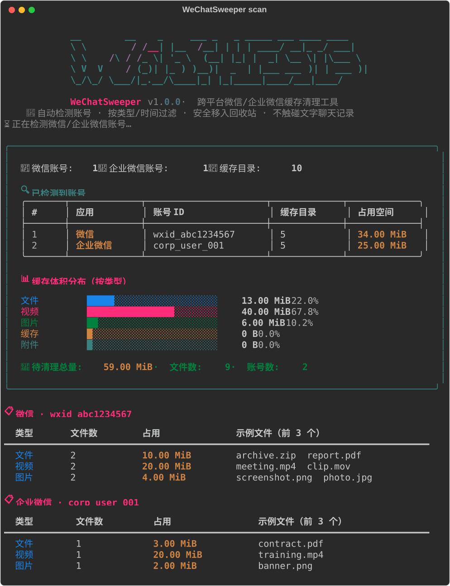
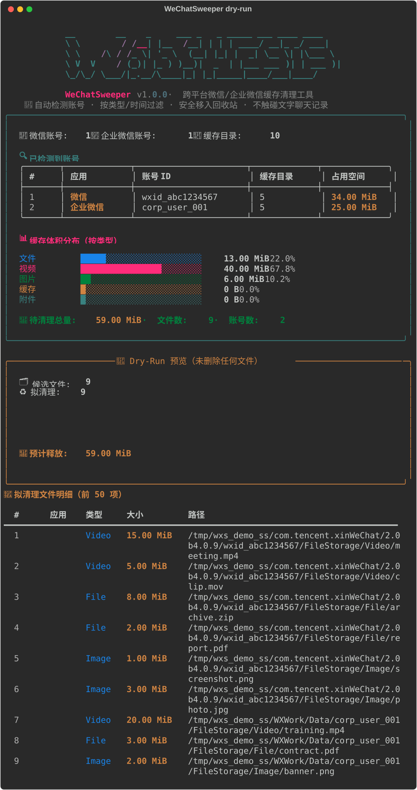
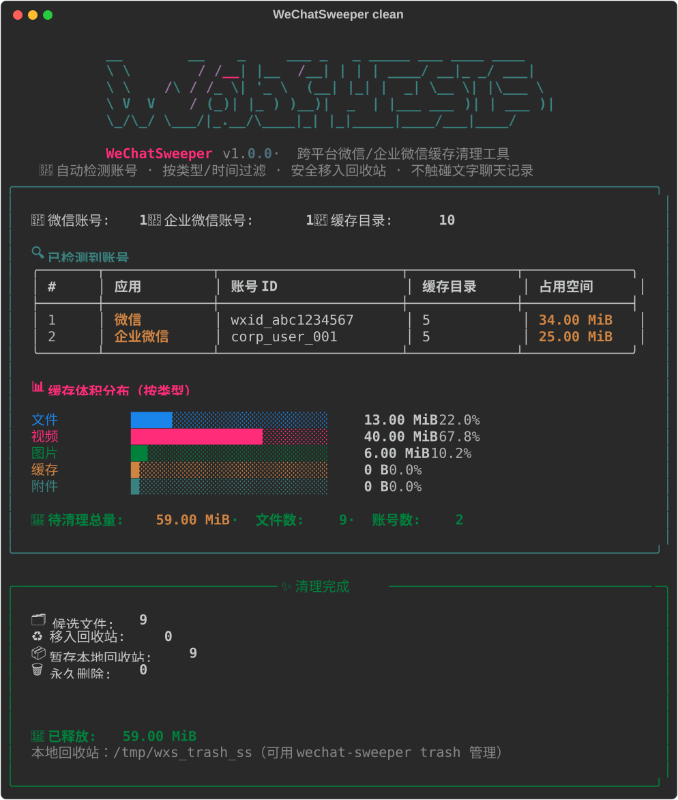

<div align="center">

# 🧹 WeChatSweeper

**跨平台微信 / 企业微信缓存清理终端工具**

自动检测本机所有微信及企业微信账号的缓存目录，按文件类型与时间过滤，
将不再需要的图片、视频、文件安全移入回收站，释放动辄数十 GB 的磁盘空间。

**Cross-platform terminal cleaner for WeChat & WeCom cache.**

[](https://github.com/zjukop3/WeChatSweeper/actions/workflows/ci.yml)
[](LICENSE)
[](https://www.python.org/)
[](#平台支持)
[](https://github.com/zjukop3/WeChatSweeper/stargazers)

</div>

---

> 💡 **为什么有这个项目？** 微信用一两年就能吃掉 **30~50GB** 磁盘，其中绝大多数是各大群聊里自动下载的、与你无关的视频、图片、文件，而且几年前的文件还赖在电脑里。WeChatSweeper 把这些缓存一次性扫出来、按需清理，而你的**文字聊天记录一行都不会动**。

## ✨ 特性

- 🔍 **自动识别账号**：自动发现本机所有微信及企业微信账号（含最新版微信 4.0+），无需手动配置。
- 🖥️ **真正跨平台**：macOS / Windows / Linux（含官方 Linux 微信与 Wine 微信）全覆盖。
- 🎛️ **自由过滤**：按类型（文件 / 视频 / 图片 / 缓存 / 附件）和"距离时间"（默认 365 天）自由组合。
- 🧪 **Dry-Run 预览**：先看清楚要删什么、删多少，再决定是否执行。
- ♻️ **安全回收站**：默认移入系统回收站，可恢复；系统回收站不可用时**自动回退到本地托管回收站**，保证始终可用。
- 📊 **可视化报告**：基于 [rich](https://github.com/Textualize/rich) 的彩色仪表盘、类型分布条形图、进度条。
- ⏰ **定时清理**：一键安装定时任务（macOS launchd / Linux cron / Windows 计划任务），定期自动释放空间。
- 🛡️ **安全优先**：只清理 `FileStorage` 下的媒体与缓存，**绝不触碰**存放文字记录的 `Message` 数据库；带符号链接逃逸防护。
- ⚡ **零编译、单命令安装**：`pipx install wechat-sweeper` 即可，纯 Python，无 Electron 体积负担。

## 📸 运行截图

<table>
<tr>
<td align="center"><b>🔍 扫描仪表盘</b></td>
<td align="center"><b>🧪 Dry-Run 预览</b></td>
<td align="center"><b>✨ 清理完成</b></td>
</tr>
<tr>
<td></td>
<td></td>
<td></td>
</tr>
</table>

## 🚀 快速开始

```bash
# 安装（任选其一）
pipx install wechat-sweeper
# 或
pip install --user wechat-sweeper

# ① 扫描：看看能清理多少（只读，不删除）
wechat-sweeper scan

# ② 预览：列出将清理哪些文件（不删除）
wechat-sweeper clean --dry-run

# ③ 清理：移入回收站，可恢复
wechat-sweeper clean --yes
```

> 不带子命令直接运行 `wechat-sweeper` 进入交互式菜单，按提示操作即可。

## 📦 安装

### 方式一：pipx（推荐，隔离环境）

```bash
pipx install wechat-sweeper
```

### 方式二：pip

```bash
pip install --user wechat-sweeper
```

### 方式三：从源码

```bash
git clone https://github.com/zjukop3/WeChatSweeper.git
cd WeChatSweeper
pip install -e .
```

> 也提供短命令 `wxs`，等价于 `wechat-sweeper`。

## 📖 用法

### 扫描（只读统计）

```bash
wechat-sweeper scan                          # 扫描所有自动检测到的账号
wechat-sweeper scan --root ~/WeChatFiles     # 指定自定义微信数据目录
wechat-sweeper scan --days 180 --types video image   # 只看 180 天前的视频与图片
```

### 清理

```bash
wechat-sweeper clean --dry-run               # 预览，不删除
wechat-sweeper clean --yes                   # 移入回收站（默认）
wechat-sweeper clean --permanent --yes       # 永久删除（不可恢复，谨慎）
wechat-sweeper clean --days 180 --types video image file   # 自定义类型与时间
```

| 选项 | 说明 |
| --- | --- |
| `--root PATH` | 自定义微信数据目录（可多次指定） |
| `--days N` | 仅清理 N 天前的文件（默认取配置，初始 365） |
| `--types a b c` | 文件类型，可选：`file video image cache attach` |
| `--dry-run` | 仅预览不执行 |
| `--permanent` | 永久删除（默认移入回收站） |
| `--yes / -y` | 跳过交互确认 |

### 配置

```bash
wechat-sweeper config show                      # 查看当前配置
wechat-sweeper config set days 180               # 保留天数
wechat-sweeper config set types video,image,file # 启用类型
wechat-sweeper config set root "/path/to/wx"     # 持久指定数据目录
wechat-sweeper config set trash false            # 切换为永久删除
wechat-sweeper config reset                      # 重置
```

配置文件位置：`~/.config/wechatsweeper/config.json`（macOS/Linux）、`%APPDATA%\WeChatSweeper\config.json`（Windows）。

### 定时清理

```bash
wechat-sweeper schedule install --hours 168   # 每周自动清理一次
wechat-sweeper schedule status                # 查询状态
wechat-sweeper schedule uninstall             # 卸载
```

### 管理本地托管回收站

当系统回收站因权限/沙盒不可用时，文件会暂存到本地托管回收站：

```bash
wechat-sweeper trash path     # 查看路径与占用
wechat-sweeper trash empty    # 清空
```

> 也可用环境变量 `WECHATSWEeper_TRASH_DIR` 指定托管回收站位置（便于容器/CI）。

## 🛡️ 安全说明

- ✅ **只清理缓存**：仅处理 `FileStorage/` 下的 `File`、`Video`、`Image`、`Cache`、`Attach`、`CDNFileStorage` 等缓存子目录。
- 🚫 **不碰聊天记录**：存放文字消息的 `Message/` 数据库**绝不会被扫描或删除**。
- ♻️ **默认可恢复**：移入系统回收站，错了还能捞回来。
- 🔒 **路径边界防护**：删除前校验文件确实位于受信任缓存目录内，防止符号链接逃逸。
- 🧪 **先预览后执行**：`--dry-run` 让你 100% 掌控将删什么。

## 🔧 工作原理

WeChatSweeper 在各平台默认候选目录下做**有界深度搜索**，凡直接包含 `FileStorage` 子目录的目录即视为一个账号目录，再在其中定位已知缓存子目录：

| 平台 | 候选目录（示例） |
| --- | --- |
| macOS | `~/Library/Containers/com.tencent.xinWeChat/...`、企业微信 `com.tencent.WeWork` |
| Windows | `Documents\WeChat Files\`、`Documents\WXWork\`、`%APPDATA%\Tencent\xwechat` |
| Linux | `~/.config/tencent-wxwechat`、`~/.config/wechat`、Wine 目录 |

未自动检测到？用 `--root` 指定你的微信数据目录，或 `config set root` 持久保存。

## 🌐 平台支持

| 平台 | 个人微信 | 企业微信 |
| --- | --- | --- |
| macOS | ✅ | ✅ |
| Windows | ✅ | ✅ |
| Linux | ✅（官方 / Wine） | ✅（Wine） |

## ❓ FAQ

**Q：会删除我的聊天记录吗？**
A：不会。工具只清理 `FileStorage` 下的媒体与缓存文件，文字聊天记录数据库完全不受影响。

**Q：删错了怎么办？**
A：默认移入系统回收站，去回收站恢复即可。若系统回收站不可用，会暂存到本地托管回收站（`wechat-sweeper trash path` 查看）。

**Q：找不到微信数据？**
A：用 `wechat-sweeper scan --root <你的微信数据目录>` 指定，或运行 `config set root` 持久保存。

**Q：和 CleanMyWechat 有什么区别？**
A：本工具是**跨平台终端工具**（含 Linux），开箱即用单命令安装、无 GUI/Electron 体积负担，提供 Dry-Run 预览、托管回收站兜底、可编程定时任务，适合开发者和服务器场景。向 [blackboxo/CleanMyWechat](https://github.com/blackboxo/CleanMyWechat) 致敬与致谢，正是它启发了本项目。

## 🤝 贡献

欢迎 Issue / PR！开发：

```bash
git clone https://github.com/zjukop3/WeChatSweeper.git
cd WeChatSweeper
python -m venv .venv && . .venv/bin/activate
pip install -e ".[dev]"
pytest            # 跑测试（合成数据，无需真实微信）
python scripts/make_screenshots.py   # 重新生成 README 截图
```

## 📝 许可证

[MIT License](LICENSE)。

## 🙏 致谢

- [blackboxo/CleanMyWechat](https://github.com/blackboxo/CleanMyWechat) —— 灵感来源，致敬原作者解决微信吃磁盘这一全民痛点。
- [Textualize/rich](https://github.com/Textualize/rich) —— 美丽的终端渲染。

---

<div align="center">

**如果这个工具帮到了你，点个 ⭐ Star 让更多人看到，非常感谢！**

</div>
